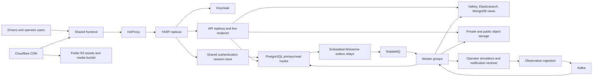
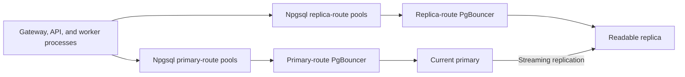
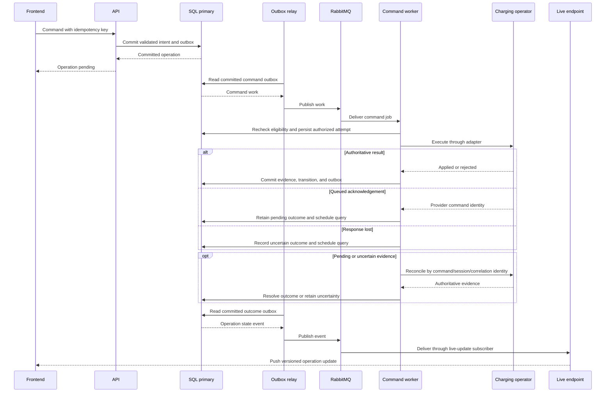

# EV Charging System Architecture

## 1. Purpose and scope

The platform is a system-design lab with a .NET/C# backend and a shared frontend
for drivers and operator users. It models production component interactions under
bounded synthetic load, including concurrency, dependency failures, and uncertain
external effects.

Drivers discover stations, reserve connectors, control charging, follow progress,
and download session summaries. Operator users maintain assigned station content,
inspect sessions and attempts, request reconciliation, and download diagnostics.
Infrastructure fault injection belongs to the test harness rather than the UI.

Billing, payments, tariffs, roaming, route planning, fleet management, and a
general maintenance platform are outside the product scope. Production capacity
planning, availability commitments, multi-region recovery, and operational
hardening are also excluded.

The documentation separates five concerns:

| Reference | Responsibility |
|---|---|
| [Domain](domain.md) | Vocabulary, permissions, reservation rules, lifecycle, and evidence semantics |
| Architecture | Components, data ownership, processing paths, and technical boundaries |
| [Integrations](integrations.md) | External simulator contracts and adapter obligations |
| [Lab](lab.md) | Execution profiles, timing defaults, fault scenarios, and verification |
| [Implementation plan](implementation-plan.md) | Milestones, dependencies, task tracking, and acceptance criteria |

## 2. Technology selections

| Area | Selection |
|---|---|
| Backend | .NET 10 LTS, C# 14, ASP.NET Core 10; Minimal APIs, OpenAPI, Problem Details |
| Orchestration | Aspire 13.6, C# AppHost; local processes and Linux OCI containers through Docker |
| Frontend | React 19, TypeScript, Vite, React Router, TanStack Query, Mantine |
| Gateway / load balancer | YARP / HAProxy |
| Identity | Keycloak; gateway-hosted OIDC Authorization Code with PKCE and ASP.NET Core cookie authentication |
| Live delivery | SignalR .NET/JavaScript clients; StackExchange.Redis backplane connected to Valkey |
| Relational persistence | PostgreSQL 17; EF Core 10 with Npgsql provider; Npgsql data sources |
| Database-side pooling | PgBouncer, transaction mode |
| Managed database exercise | Azure Database for PostgreSQL Flexible Server, readable replica and provider-managed HA |
| Documents | MongoDB; official C# driver |
| Cache | Valkey; StackExchange.Redis |
| Search | Elasticsearch; official Elastic .NET client |
| Jobs and business events | RabbitMQ; Wolverine RabbitMQ transport |
| Inbox, outbox, scheduling | Wolverine with EF Core/PostgreSQL persistence |
| Observation stream | Kafka in KRaft mode; Confluent.Kafka C# client |
| Object storage | Cloudflare R2 / local S3-compatible container; `AWSSDK.S3` |
| CDN | Cloudflare CDN, Free plan; R2 custom domain |
| File processing | SkiaSharp for images; PDFsharp for summaries; .NET ZIP/JSON for diagnostics |
| HTTP resilience | Microsoft.Extensions.Http.Resilience and Polly |
| Observability | OpenTelemetry .NET/browser instrumentation, Collector, Prometheus, Loki, Tempo, Grafana; Aspire dashboard |

Compatible stable client libraries are pinned through central NuGet management
and the frontend lockfile. Infrastructure images use explicit versions.
The monorepo has `src`, `infra`, `tests`, `docs`, and `tools` at the top level;
subdirectories follow implementation needs. Configuration and secrets are external
to source control.

[.NET support policy](https://dotnet.microsoft.com/en-us/platform/support/policy/dotnet-core),
[Aspire 13.6](https://aspire.dev/whats-new/aspire-13-6/)

## 3. Components and request topology

HAProxy balances gateway replicas; YARP balances individual API destinations.
The gateway also acts as the backend for frontend (BFF), owning browser sessions
and OIDC interactions. APIs enforce resource authorization and business validation.
Local HTTPS uses development certificates.

The gateway serves the SPA entry page. `/auth`, `/identity`, `/api`, and `/live`
routes share that public origin. Versioned frontend assets and published media use the CDN;
authorized file transfers use storage URLs. Authentication and API routes bypass
CDN caching.

| Component | Purpose |
|---|---|
| Frontend | Driver/operator navigation, gateway session discovery, asynchronous operations, uploads, progress, and reconnect |
| Keycloak | Authentication and token issuance; application permissions remain separate |
| HAProxy | Health-aware ingress routing and gateway-instance failure exercise |
| YARP replicas / BFF | Browser sessions, OIDC login/logout and token refresh, public routes, admission controls, and API-instance balancing |
| API replicas | Command/query handling, resource permissions, and file authorization |
| Live endpoint | Browser updates; snapshot recovery makes missed pushes recoverable |
| Workflow coordinator | Transactional reservation, operation, session, and outbox changes |
| Operator adapters | Provider calls and canonical normalization |
| Observation ingestion | Validate callbacks/poll results and append to the durable stream |
| Observation processors | Latest views, aggregation, stalled-session detection, and lifecycle evidence |
| Scheduler / reconciliation workers | Persisted deadlines, due work, and external outcome queries |
| Projection workers | Search, cache, and document views |
| Media / document workers | Image variants, publication, summaries, and diagnostic bundles |
| Notification worker | External delivery and persisted delivery attempts |
| Outbox relay | Publish committed messages and recover after process loss |

Logical roles are assigned to a gateway deployment, an API deployment, and three
independent worker deployments. Replicas of a deployment share its responsibilities.

| Host | Responsibilities |
|---|---|
| Gateway / BFF | Browser authentication sessions, OIDC interactions, public routing, and API-instance balancing |
| API | Command/query acceptance, transactional intent, file authorization, observation callback ingestion, and SignalR connections/live-event subscription |
| Charging worker | Start/stop effects, reservation expiry, reconciliation, recovery polling through observation ingestion, and recurring due-work discovery |
| Observation/projection worker | Kafka consumers, MongoDB history/latest views, Valkey/Elasticsearch projections, SQL lifecycle/final-usage processing, stalled-session detection, and isolated rebuilds |
| File/notification worker | Media processing/publication, summaries, diagnostic bundles, upload/orphan sweeps, and notification delivery |

Recurring producers run with their owning workload: reconciliation/recovery
polling in the charging worker and upload/orphan sweeps in the file worker.
Stalled-session detection submits durable reconciliation work to the charging
worker. Files and notifications have separate queues, concurrency budgets, and
retry policies. Loss of all file/notification instances pauses both workloads;
durable work resumes after recovery, independently of charging execution.

The outbox relay is an embedded Wolverine runtime role in each message-producing
API/worker deployment. The topology diagram represents logical roles rather than
one process per node. No process-local state is the sole record of an accepted
operation.

## 4. Data ownership

| Data | Authority / store | Derived paths |
|---|---|---|
| Station/equipment identities, assignments, descriptions | PostgreSQL primary | Replica, search, cache |
| Reservations, session lifecycle, final usage | PostgreSQL primary | Replica and frontend views |
| Operations, attempts, deadlines, inbox/outbox, notification attempts | PostgreSQL primary | Investigation views |
| Gateway authentication tickets and token state | PostgreSQL primary, dedicated session records | Shared by gateway replicas; authoritative reads bypass replicas and disposable cache |
| File ownership, processing state, publication references | PostgreSQL primary | Object delivery and media views |
| Accepted raw/normalized observation envelopes | Kafka | Independent consumer groups |
| Provider-shaped documents, observation history, latest observations | MongoDB projections | Valkey and diagnostic queries |
| Hot query results | Valkey | Reconstructable from owning stores |
| Station text, location, capabilities, advisory availability | Elasticsearch | Rebuildable discovery index |
| Originals, media variants, summaries, diagnostic bytes | Object storage | CDN or private signed transfers |

PostgreSQL owns platform decisions; the charging operator owns physical state.
Kafka is the durable acceptance boundary for observations, not an event store for
all business entities. MongoDB serves independent observational and diagnostic
queries; cache and search loss do not invalidate transactional records.

[Domain policies](domain.md#5-reservations) are enforced in primary-side
transactions. PostgreSQL range/exclusion constraints with `btree_gist` reject
overlapping reservations across API instances. Session exclusivity and permitted
transitions use transactional constraints or conditional updates. Operation
identity prevents duplicate command acceptance. Observation projections use the
[domain ordering rules](domain.md#8-time-identity-and-ordering).

[PostgreSQL range constraints](https://www.postgresql.org/docs/17/rangetypes.html#RANGETYPES-CONSTRAINT),
[btree_gist](https://www.postgresql.org/docs/17/btree-gist.html)

## 5. Read and write paths

Command and query handlers select separate data sources within the same API
deployment. EF Core handles transactional persistence and migrations. Read
contexts use no tracking and explicit projections; parameterized Npgsql SQL is
available for PostgreSQL-specific queries. Contexts reuse long-lived data sources
rather than creating connection pools per request.

| Request | Destination |
|---|---|
| Commands, eligibility/conflict checks, lifecycle transitions, critical authorization | Primary |
| Immediate write confirmation and reads requiring the new result | Command result or primary |
| Catalog and session-history lists | Replica, optionally cache |
| Station discovery | Elasticsearch |
| Current progress | MongoDB latest view / Valkey, plus live updates |
| Diagnostics | MongoDB observations and SQL attempt records |
| Published media | CDN |
| Private files | Authorized signed object-storage URL |

Replica lag/outage triggers bounded primary fallback for admitted queries.
Other requests return a recoverable unavailable response or an explicitly stale
view. The [lab profile](lab.md#2-default-timings) defines lag tolerance. Writes
return committed identifiers/state, so a lagging history list cannot erase their
immediate confirmation.

Search failure permits a limited SQL station lookup within an admission budget.
Cache bypass uses bounded fallback, stampede controls, and gradual warm-up.
Elasticsearch rebuilds from canonical station data and selected observations;
replacement indexes are validated before switchover.

## 6. PostgreSQL topology and pooling

Each process reuses Npgsql data sources and borrows connections for short
operations. Disposal returns connections to the pool. No transaction remains open
during a provider call, upload, or notification. Connection pooling is separate
from ORM context pooling.

Application-to-pooler and pooler-to-database budgets are measured separately.
Client limits multiply across processes and routes; server pools also depend on
pooler instances and database/user combinations. Two APIs with eight connections
each and two workers with four each allow 24 clients on one route. A smaller
server pool exposes waiting under modest load.
Gateway authentication-store connections have a separate primary-route pool and
are included in the aggregate budget.

Connection acquisition, SQL commands, and transactions have bounded waits and
cancellation. Transaction pooling is the baseline; session pooling is a comparison
route for session-affine features. Session state, advisory locks, temporary objects,
and prepared statements require compatibility checks. Migrations use a dedicated
direct connection.

Local traffic uses separate primary and replica PgBouncer containers. The Azure
exercise uses managed pooler endpoints on port 6432 and direct connections on
5432. Routing targets configured pooler endpoints; native Npgsql multi-host routing
is an optional direct-connection comparison, not another required proxy.

Azure owns HA failure detection, safe promotion, split-brain prevention, and
primary endpoint switching. The HA standby supports failover; the asynchronous
readable replica serves queries. The application owns bounded reconnect and
uncertain-commit resolution: a lost commit response is checked by operation
identity on the authoritative database. Reconnect cannot restore an interrupted
transaction or establish whether it committed.

[Npgsql lifecycle](https://www.npgsql.org/doc/basic-usage.html),
[Npgsql routing](https://www.npgsql.org/doc/failover-and-load-balancing.html),
[PgBouncer compatibility](https://www.pgbouncer.org/features.html),
[Azure PgBouncer](https://learn.microsoft.com/en-us/azure/postgresql/connectivity/concepts-pgbouncer),
[Azure replica poolers](https://learn.microsoft.com/en-us/azure/postgresql/read-replica/concepts-read-replicas-promote),
[Azure HA](https://learn.microsoft.com/en-us/azure/postgresql/flexible-server/concepts-high-availability)

## 7. Jobs, business events, and scheduling

RabbitMQ carries two workloads:

- Competing-consumer jobs execute commands, reconciliation, media processing,
  document generation, and notifications.
- Topic exchanges route committed business events to independent subscriber
  queues for projections, notifications, and derived work.

Queues isolate provider calls, files, notifications, and projections. Each has a
bounded concurrency budget; provider-specific limits prevent one failing operator
from consuming all worker capacity. Acknowledgements follow durable handling.
Bounded retries and dead-letter inspection isolate poison work.

Wolverine commits business changes and outgoing envelopes in one EF Core/PostgreSQL
transaction. Its relay publishes with broker confirmation. A crash between publish
and recorded success can produce duplicate delivery. SQL consumers commit inbox
deduplication with their mutations; external effects retain separate durable
attempts and require the [integration safety contract](integrations.md#2-command-safety).

API, charging, observation/projection, and file/notification hosts use distinct
Wolverine message-storage schemas in the same application database. Replicas of
one host type share its schema and recovery coordination. Each host registers
only its own handlers/listeners; business mutations and that host's outgoing
envelopes still commit in the same database transaction. Wolverine's hosted
durability runtime recovers stranded inbox/outbox work for that host family.

Persisted scheduled messages represent expiry deadlines and delayed retries.
Scheduled jobs route to the owning worker queues. Recurring producers rescan
persisted due state after startup and periodically submit reconciliation or cleanup
work. Stable job IDs and database uniqueness make duplicate scheduling across
replicas safe; handlers recheck current state rather than treating a scheduled
message as authority. Aspire manages the hosts; Wolverine handles persisted
message scheduling and recovery inside them.

Envelopes include event ID, schema version, entity ID/version, occurrence and receipt
times, correlation/causation IDs, and trace context. They omit secrets and private
file URLs. Contracts support backward-compatible changes.

[Wolverine durability](https://wolverinefx.net/guide/durability/),
[Wolverine PostgreSQL storage](https://wolverinefx.net/guide/durability/postgresql),
[EF Core integration](https://wolverinefx.net/guide/durability/efcore/),
[RabbitMQ reliability](https://www.rabbitmq.com/docs/reliability)

## 8. Observation ingestion and streams

1. Authenticate the source and validate payload size, shape, IDs, and timestamps.
2. Build a versioned envelope with raw payload, normalized fields, provider/source
   identity, connector sequence, and occurrence/receipt times.
3. Append durably to Kafka before acknowledging the callback.
4. Independent C# consumer groups materialize documents, latest views, aggregates,
   and lifecycle evidence.

Kafka keys use provider and connector identity. Bounded raw payloads stay in the
envelope so MongoDB failure cannot lose accepted data. Large diagnostics use object
storage. Unconfirmed appends receive no success acknowledgement; ambiguous appends
can yield duplicates handled by source identity. Callback retry and polling behavior
are defined in [integrations](integrations.md#3-observations-and-recovery).

Offsets advance after durable effects. SQL lifecycle processing commits
deduplication, state, and outbox together. Multi-store projections use idempotent,
version-conditional updates because SQL, MongoDB, and Valkey cannot share a
transaction. MongoDB's latest view is the fallback after cache loss.

Consumer lag is visible and limited by stream retention. Aggregation state has
recoverable checkpoints. Replay uses isolated consumers and rebuild targets,
validates the new view, then switches its published version. Rebuild consumers
cannot dispatch external effects. The identity, ordering, and freshness semantics
remain those of the [domain reference](domain.md#8-time-identity-and-ordering).

## 9. Charging workflows

### 9.1 Reservation

The API resolves request identity, authorizes the driver, and validates the
[reservation policy](domain.md#5-reservations) on the primary. One transaction
commits the reservation, deadline, result, and outbox event. The API returns the
committed result; subscribers update discovery and notifications asynchronously.
Cancellation, start acceptance, and expiry use conditional primary-side transitions.

### 9.2 Start/stop execution

The primary transaction owns operation acceptance. Start validates the reservation
window and claims connector exclusivity; stop targets an existing session and
retains its claim, without requiring an unexpired reservation. Workers recheck
command eligibility, persist attempt identity, and release SQL connections before
external calls. Reconciliation runs as separately scheduled durable work.
The [domain transition table](domain.md#62-session-lifecycle) defines resulting
states; [provider contracts](integrations.md) determine authoritative evidence.
Reconciliation requests from operator users use the same durable path and are audited.

### 9.3 Completion

Lifecycle consumers combine matching provider evidence under the
[completion policy](domain.md#7-measurements-and-completion). A transaction records
final usage and publishes completion. Independent jobs generate the private
summary and deliver notifications; their failures do not roll back charging facts.

## 10. Object storage and CDN

| Content | Delivery |
|---|---|
| Versioned frontend assets and published station media | Public R2 objects through Cloudflare CDN |
| Originals and pending variants | Private direct upload and worker access |
| Session summaries | Private short-lived download URL after ownership check |
| Diagnostic bundles | Private short-lived download URL after assignment check |

The storage adapter exposes upload authorization, verification, publication, and
download operations. It uses `AWSSDK.S3` against R2's S3-compatible endpoint, with
configured credentials and provider-compatible signing/checksum settings. Uploads
and private downloads use object-specific, short-lived presigned URLs. Browser
transfers require storage CORS rules for the application origin.

The local profile uses an S3-compatible container behind the same adapter. Product
selection is part of the initial topology milestone; required operations include
upload, download, HEAD verification, publication copy, deletion, and presigned transfers. Compatibility
tests cover these operations against both the local service and R2.

Public assets use a dedicated subdomain of the lab-owned domain, whose DNS is
managed by Cloudflare. The R2 custom domain belongs to a zone in the same
Cloudflare account as the bucket. Exact hostnames are environment configuration.
The `r2.dev` development endpoint does not provide CDN caching. Originals, pending
uploads, summaries, and diagnostics stay in separate private buckets without
public custom-domain access. Presigned URLs use R2's S3 API domain and cannot be
used on the public custom domain.

Media publication proceeds through private upload allocation, direct browser
transfer, verification of size/metadata and checksums where available, bounded
image decoding/variant generation, then a SQL publication transaction and outbox
event. Published bytes use a distinct
immutable key, so a reusable upload URL cannot overwrite them. The previous
version remains published until replacement is ready.

Browser completion notices and storage notifications are verified hints.
A sweep reconciles missing notices, abandoned uploads, and orphan variants.
Stable asset/version IDs make worker retries converge after partial writes.

Cloudflare cache rules cover only public assets and published media. Versioned
asset keys handle normal releases; the gateway-served entry page references the
current build. Urgent removal needs origin deletion and CDN purge, which is not
instantaneous everywhere. Warm edge caches can survive
origin loss until expiry/eviction; cold requests still require the origin. Missing
media produces a visible placeholder.

Dynamic private APIs bypass shared caching. Signed URLs are object-specific and
can remain valid until expiry. Tokens and signed URLs are redacted from logs and
bundles. Real signing, caching, and invalidation are verified against Cloudflare.

[R2 .NET client](https://developers.cloudflare.com/r2/examples/aws/aws-sdk-net/),
[R2 public buckets](https://developers.cloudflare.com/r2/buckets/public-buckets/),
[R2 presigned URLs](https://developers.cloudflare.com/r2/api/s3/presigned-urls/),
[Cloudflare cache](https://developers.cloudflare.com/cache/)

## 11. Frontend and live delivery

Mantine supplies shared UI components for the driver and operator areas. TanStack
Query manages server-data caching, mutations, and bounded refetching; SignalR
updates refresh or invalidate views. Mutation retries retain request identity.
Operation labels and observation freshness follow the domain model.
Authentication state comes from the gateway's `/auth/session` endpoint. Browser
API and live requests use the gateway session cookie; the frontend does not manage
OIDC tokens or call Keycloak directly. State-changing requests carry the gateway's
antiforgery token. An expired session produces an explicit sign-in state rather
than a browser-side token refresh.

Valkey carries SignalR fan-out as well as cache traffic, with separate prefixes,
connections, and budgets. It is transient delivery rather than a durable event log.
StackExchange.Redis remains the client for caching and the SignalR backplane;
Valkey's Redis OSS-compatible protocol supports the required commands and Pub/Sub.
Integration verification covers fan-out, disconnect, and reconnection with the
selected client/server versions.
Live-route cookie affinity keeps negotiation and transport on the same API.
Authentication-session cookies and live-affinity cookies have separate roles.

Instance loss triggers bounded reconnect/backoff, renegotiation, an authoritative
snapshot, then version-aware incremental updates. Polling is a bounded fallback.
The UI shows connection health separately from charger health and preserves
last-observation timestamps.

[SignalR scaling](https://learn.microsoft.com/en-us/aspnet/core/signalr/scale?view=aspnetcore-10.0),
[Valkey compatibility](https://valkey.io/topics/migration/),
[YARP affinity](https://learn.microsoft.com/en-us/aspnet/core/fundamentals/servers/yarp/session-affinity?view=aspnetcore-10.0)

## 12. Resilience boundaries

HTTP policies are explicit per provider and operation. Effect retries and hedging
are disabled unless permitted by the integration contract. HTTP method or library
defaults do not establish safety. A persisted operation budget covers HTTP attempts,
worker retries, and redelivery; reconciliation has a separate query budget.
[Lab defaults](lab.md#2-default-timings) set the baseline limits.

Per-dependency deadlines, cancellation, circuit breaking, concurrency limits, and
backpressure bound overload. Optional cache/search failures do not make command-capable
APIs unready. Worker admission depends on the stores required for its effects.
Readiness is workload-specific; liveness only establishes that the process runs.

Observability buffering is bounded so telemetry-backend loss does not block core
traffic. Browser, API, outbox, message, worker, and provider spans share operation,
entity, message, and correlation IDs. The Collector routes traces to Tempo, metrics
to Prometheus, and logs to Loki; Grafana combines them. Aspire provides resource
diagnostics. [Lab scenarios](lab.md#4-fault-scenarios) specify recovery evidence.

[.NET HTTP resilience](https://learn.microsoft.com/en-us/dotnet/core/resilience/http-resilience)

## 13. Security

### 13.1 Gateway authentication

The YARP application is the BFF and a confidential OIDC client. ASP.NET Core's
OpenID Connect and cookie handlers implement Authorization Code with PKCE.
The gateway owns code exchange, token refresh, and logout; client credentials and
access/refresh tokens remain server-side.

| Browser route | Responsibility |
|---|---|
| `/auth/login` | Initiate OIDC login with a validated local return URL |
| `/auth/callback` | Complete the OIDC response and establish the browser session |
| `/auth/session` | Return sign-in state, display claims, and an antiforgery token; no OIDC tokens |
| `/auth/logout` | Antiforgery-protected logout that removes the application session and initiates provider logout |
| `/identity/*` | Proxy required Keycloak login/protocol resources; administrative routes remain private |

OIDC redirects use the gateway's `/identity` origin/path for Keycloak-hosted login
pages and return to the gateway callback. Keycloak's public hostname, issuer, and
redirect URLs match that route; gateway-to-Keycloak exchanges use internal
connectivity. The browser never uses a separate Keycloak origin.
[Keycloak reverse proxy](https://www.keycloak.org/server/reverseproxy)

A PostgreSQL-backed `ITicketStore` holds authentication tickets and protected token
state shared by gateway replicas. The browser receives a protected session-reference
cookie with Secure, HttpOnly, and SameSite=Lax attributes. Gateway replicas share
Data Protection keys and application identity for authentication and affinity.
Token refresh is coordinated per session so concurrent replicas do not race a
rotating refresh token. Store unavailability fails authenticated requests explicitly;
cache eviction cannot discard authentication state.
[ASP.NET Core ticket store](https://learn.microsoft.com/en-us/dotnet/api/microsoft.aspnetcore.authentication.cookies.iticketstore?view=aspnetcore-10.0)

The gateway validates antiforgery tokens before forwarding state-changing browser
requests, including logout. API/live requests without a usable session return
unauthorized responses rather than an HTML login redirect.
[ASP.NET Core antiforgery](https://learn.microsoft.com/en-us/aspnet/core/security/anti-request-forgery?view=aspnetcore-10.0)

### 13.2 Backend authorization

The gateway strips browser-supplied authorization/identity headers and its session
cookie before attaching the session's access token to upstream API and SignalR
requests. APIs validate token signature, issuer, audience, and expiry,
then check ownership and station assignments against authoritative application
records. Gateway authentication does not replace resource authorization.
[YARP authentication](https://learn.microsoft.com/en-us/aspnet/core/fundamentals/servers/yarp/authn-authz?view=aspnetcore-10.0)

Keycloak has a dedicated PostgreSQL database and connection pool, included in
observed connection counts. Identity sessions do not depend on the disposable cache.

Callbacks, internal services, and infrastructure connections are authenticated.
Database/storage roles have least privilege; replica roles are read-only and
migrations use a separate role. Upload size, types, decoding resources, and signed
URL lifetimes are bounded. Credentials, tokens, and private user data stay out of
Git, telemetry, and diagnostics. Station edits, publication, reconciliation, and
diagnostic access are audited. All business fixtures are synthetic.

## 14. Orchestration and cloud boundaries

Aspire's C# AppHost defines processes, containers, endpoints, parameters, references,
and startup dependencies. It runs the local topology and exposes resource status;
it does not participate in charging requests or persist business work. Startup
ordering does not replace runtime recovery.
[Aspire AppHost](https://aspire.dev/hub/glossary/apphost/),
[Resource wiring](https://aspire.dev/get-started/first-app/?aspire-lang=csharp)

Aspire integrations and reusable scripts provide supported publication steps.
Managed endpoints, development certificates, and credentials come from environment
configuration or .NET user secrets.

The initial implementation milestone boots the complete local resource graph
with stub application/simulator hosts and real infrastructure containers.
Protocol-level smoke checks verify connectivity and basic operations; domain
behavior and integration semantics are implemented and verified in subsequent
[milestones](implementation-plan.md#2-suggested-order-and-dependencies).

Most components run locally. Cloudflare supplies hosted R2/CDN behavior; Azure
supplies managed PostgreSQL failover. These provider responsibilities are not
implemented in the application. The [lab profiles](lab.md#1-execution-profiles) define which resources
are active for each exercise.

Portability rests on configurable endpoints and PostgreSQL, MongoDB, Valkey's RESP
protocol, Elasticsearch, RabbitMQ, Kafka, S3-compatible storage operations, OIDC,
OpenTelemetry, and OCI interfaces. PostgreSQL replication/transaction behavior
remains database-specific; S3 compatibility is limited to verified operations.
Storage signing/configuration and CDN publication/purge remain adapter boundaries.
