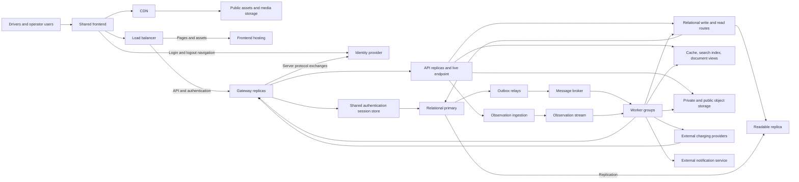
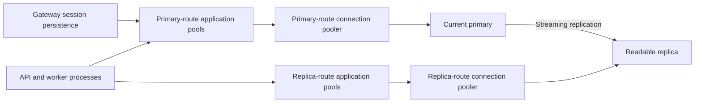
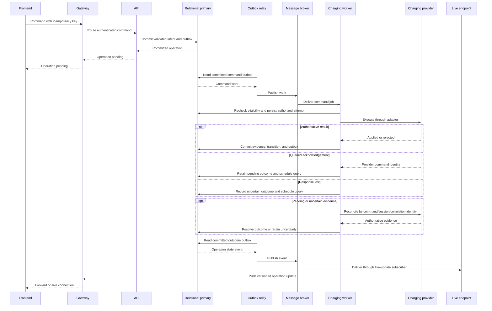

# EV Charging System Architecture

## 1. Purpose and scope

The platform is an EV charging system with a shared frontend for drivers and
operator users. The lab models production component interactions under
bounded synthetic load, including concurrency, dependency failures, and uncertain
external effects.

Drivers discover stations, reserve connectors, control charging, follow progress,
and download session summaries. Operator users maintain assigned station content,
inspect sessions and attempts, request reconciliation, and download diagnostics.
Infrastructure fault injection belongs to the test harness rather than the UI.

Billing, payments, tariffs, roaming, route planning, fleet management, and a
general maintenance platform are outside the product scope. Production capacity
planning, availability commitments, multi-region recovery, and operational
hardening are also excluded.

The documentation separates these concerns:

| Reference | Responsibility |
|---|---|
| [Domain](domain.md) | Vocabulary, permissions, reservation rules, lifecycle, and evidence semantics |
| Architecture | Components, data ownership, processing paths, and failure boundaries |
| [Integrations](integrations.md) | Third-party contracts, simulators, and adapter obligations |
| [Lab](lab.md) | Technology selections, implementation constraints, execution profiles, and verification |
| [Implementation plan](implementation-plan.md) | Milestones, dependencies, task tracking, and acceptance criteria |

## 2. Design principles

- Authoritative transactions decide reservations, operations, and session state.
  Derived views support discovery and progress without becoming decision authority.
- Accepted work survives process loss. Durable messaging separates request
  acceptance from external effects and independently recoverable background work.
- Read and write paths have separate consistency and resource budgets.
- Workloads have distinct failure boundaries. Search, caching, media, and
  notifications can fail independently of charging execution.
- All application requests to platform APIs pass through the gateway; APIs
  retain responsibility for authorization and business validation.
- External effects can be uncertain. Durable attempt records and reconciliation
  resolve outcomes according to the provider contract.

Concrete products, libraries, and deployment profiles are selected in the
[lab reference](lab.md).

## 3. Components and request topology

The ingress load balancer routes frontend requests to frontend hosting and API
and authentication requests to the logical gateway service. The gateway routes
API requests to the logical internal API service. The deployment
runtime balances traffic across replicas of each service. Replica selection may
be provided by service endpoints or by routing components with discovered
destinations, without making individual instances application routing contracts.
The gateway also acts as the backend for frontend (BFF), owning browser sessions
and identity-provider interactions. APIs enforce resource authorization and
business validation.

All application HTTP calls to platform-owned APIs pass through the gateway:
browser requests, worker submissions, and provider callbacks. The gateway routes
each request to its owning internal API. Charging-worker recovery polling calls
the provider directly and submits the resulting observations through the gateway
to ingestion. Outbound integration calls use external service endpoints.
Orchestration health checks
address hosts directly.

Frontend hosting serves the entry page independently of the gateway.
Gateway authentication, API, and live-update routes share the frontend's public origin.
Versioned frontend assets and published media use the CDN;
authorized file transfers use storage URLs. Authentication and API routes bypass
CDN caching.

| Supporting component | Purpose |
|---|---|
| Frontend | Driver/operator navigation, gateway session discovery, asynchronous operations, uploads, progress, and reconnect |
| Identity provider | Authentication and token issuance; application permissions remain separate |
| Load balancer | Health-aware ingress routing to frontend hosting and the gateway service |
| External charging providers | Equipment control and physical-state evidence through distinct [command contracts](integrations.md#1-provider-contracts) |
| External notification service | Delivery acceptance and outcomes through an outbound adapter |

Logical roles are assigned to a gateway deployment, an API deployment, and six
independent worker deployments. Replicas of a deployment share its responsibilities.

| Host | Responsibilities |
|---|---|
| Gateway / BFF | Browser authentication sessions, identity-provider interactions, and browser/service/callback routing to runtime-balanced API services |
| API | Command/query acceptance, transactional reservation/operation/session intent, file authorization, observation ingestion, and live connections/event subscription |
| Charging worker | Charging-provider adapters and start/stop effects, reservation expiry, reconciliation, recovery polling through observation ingestion, and recurring due-work discovery |
| Observation worker | Stream consumers, document history/latest views, transactional lifecycle/final-usage processing, stalled-session detection, and isolated observation-view replay |
| Search index worker | Station/business-event and observation consumers, search indexing, replacement-index rebuilds, validation, and switchover |
| Cache worker | Business-event and observation consumers, versioned cached query-view updates, invalidation, and bounded warming/recovery |
| Media worker | Media processing/publication, summaries, diagnostic bundles, and upload/orphan sweeps |
| Notification worker | External notification delivery through a provider adapter, retries, and persisted delivery attempts |

Recurring producers run with their owning workload: reconciliation/recovery
polling in the charging worker and upload/orphan sweeps in the media worker.
Stalled-session detection submits durable reconciliation work to the charging
worker. Each worker deployment has independent queues, concurrency budgets, retry
policies, and durable recovery. Failure of one workload does not pause unrelated
worker workloads.

Notification jobs remain provider-independent. Delivery acceptance and uncertainty
follow the [notification integration contract](integrations.md#4-notification-providers).

Search indexing and cache maintenance use separate deployments, subscriber queues,
and stream consumer groups. Each owns its checkpoints and recovery. Loss or rebuild
of either derived store does not pause observation history or session-evidence
processing. API cache reads, request-time fills, and bounded fallback remain in
the API; the cache worker owns asynchronous maintenance of cached query views.
Live-update fan-out remains an API responsibility.

The outbox relay is an embedded role in each message-producing
API/worker deployment. The topology diagram represents logical roles rather than
one process per node. No process-local state is the sole record of an accepted
operation.

## 4. Data ownership

| Data | Authority / store | Derived paths |
|---|---|---|
| Station/equipment identities, assignments, descriptions | Relational primary | Replica, search, cache |
| Reservations, session lifecycle, final usage | Relational primary | Replica and frontend views |
| Operations, attempts, inbox/outbox, notification attempts | Relational primary | Investigation views |
| Gateway authentication tickets and token state | Relational primary, dedicated session records | Shared by gateway replicas; authoritative reads bypass replicas and disposable cache |
| File ownership, processing state, publication references | Relational primary | Object delivery and media views |
| Accepted raw/normalized observation envelopes | Durable stream | Independent consumer groups |
| Provider-shaped documents, observation history, latest observations | Document database projections | Cache and diagnostic queries |
| Hot query results | Cache | Reconstructable from owning stores |
| Station text, location, capabilities, advisory availability | Search index | Rebuildable discovery index |
| Originals, media variants, summaries, diagnostic bytes | Object storage | CDN or private signed transfers |

The relational database owns platform decisions; the charging provider owns
physical state. The stream is the durable acceptance boundary for observations,
not an event store for all business entities. The document database serves
independent observational and diagnostic queries; cache and search loss do not
invalidate transactional records.

Authentication and charging records have separate ownership and access boundaries
within the relational store. Each owner controls its schema changes; application
processes use scoped runtime credentials. Separate schemas share database capacity
and availability. Message-storage ownership follows each API/worker host family.

[Domain policies](domain.md#5-reservations) are enforced in primary-side
transactions. Database constraints preserve reservation/session exclusivity and
permitted transitions across API instances. Operation identity prevents duplicate
command acceptance. Observation projections follow the
[domain ordering rules](domain.md#8-time-identity-and-ordering).

### 4.1 Audit history

The platform maintains shared, append-only audit history in the relational store.
Records identify the authenticated actor, time, action, affected resource, and
structured details.

- Automatic change records use add/update/delete actions and explicitly selected
  entity properties.
- Explicit events express business intent, including publication, reconciliation
  requests, and diagnostic access. Each action uses one capture path to avoid
  duplicate records.

Business changes and their audit records commit together; a failed transaction
persists neither. External request acceptance and confirmed outcomes are distinct
events. Audit history preserves attribution; diagnostic logs, outgoing messages,
and operational state retain their separate responsibilities.

Only selected fields are collected; credentials, tokens, and signed URLs are
excluded. Audit queries enforce the affected resource's access rules.

## 5. Read and write paths

Command and query handling use distinct database routes within the same API
deployment. Critical decisions use authoritative primary-side state; query views
can lag and expose their freshness.

| Request | Destination |
|---|---|
| Commands, eligibility/conflict checks, lifecycle transitions, critical authorization | Primary |
| Immediate write confirmation and reads requiring the new result | Command result or primary |
| Catalog and session-history lists | Replica, optionally cache |
| Station discovery | Search index |
| Current progress | Document latest view / cache, plus live updates |
| Diagnostics | Document observations and relational attempt records |
| Published media | CDN |
| Private files | Authorized signed object-storage URL |

Replica lag/outage triggers bounded primary fallback for admitted queries.
Other requests return a recoverable unavailable response or an explicitly stale
view. The [lab profile](lab.md#22-default-timings) defines lag tolerance. Writes
return committed identifiers/state, so a lagging history list cannot erase their
immediate confirmation.

Search failure permits a limited relational station lookup within an admission budget.
Cache bypass uses bounded fallback, stampede controls, and gradual warm-up.
The search index rebuilds from canonical station data and selected observations;
replacement indexes are validated before switchover.

## 6. Relational topology and pooling

Each process reuses application connection pools for short database operations.
Poolers separately limit database sessions. No transaction remains open during
a provider call, upload, or notification.

Application-to-pooler and pooler-to-database budgets are measured separately.
Aggregate budgets include every process, route, and pooler, including the gateway
session store.
Connection acquisition, database commands, and transactions have bounded waits
and cancellation.

Primary and replica traffic use separate pooler routes. The managed database
provider owns high-availability failure detection, safe promotion, split-brain
prevention, and primary endpoint switching. The HA
standby supports failover; the asynchronous readable replica serves queries.

The application owns bounded reconnect and uncertain-commit resolution: a lost
commit response is checked by operation identity on the authoritative database.
Reconnect cannot restore an interrupted transaction or establish whether it committed.
[Pooling setup](lab.md#13-postgresql-access-and-pooling)

## 7. Jobs, business events, and scheduling

The message broker carries two workloads:

- Competing-consumer jobs execute commands, reconciliation, media processing,
  document generation, and notifications.
- Topics route committed business events to independent subscriber
  queues for projections, notifications, and derived work.

Queues isolate provider calls, files, notifications, and projections. Each has a
bounded concurrency budget; provider-specific limits prevent one failing provider
from consuming all worker capacity. Acknowledgements follow durable handling.
Bounded retries and dead-letter inspection isolate poison work.

Business changes and outgoing messages commit in one relational transaction.
The outbox relay publishes with broker confirmation. A crash between publish
and recorded success can produce duplicate delivery. Transactional consumers commit inbox
deduplication with their mutations; external effects retain separate durable
attempts and require the applicable [integration contract](integrations.md).

Each host family owns its handlers and durable-message recovery boundary.
Replicas coordinate recovery of stranded inbox/outbox work within that boundary.

Persisted scheduled messages represent expiry deadlines and delayed retries.
Scheduled jobs route to the owning worker queues. Recurring producers rescan
persisted due state after startup and periodically submit reconciliation or cleanup
work. Handlers coordinate conditional transitions and recheck current state rather
than treating a scheduled message as authority; duplicate submissions are harmless.
An overdue reservation sweep runs at startup and periodically, submitting expiry
checks for bounded batches of active reservations past their expiry time. It reads
reservation state directly and complements durable message recovery; duplicate
checks cannot repeat a completed transition.
The orchestrator manages host lifecycles; the messaging runtime handles persisted
scheduling and durable message recovery.
[Message persistence](lab.md#14-message-persistence-and-envelopes)

## 8. Observation ingestion and streams

1. Authenticate the source and validate payload size, shape, IDs, and timestamps.
2. Build a versioned envelope with raw payload, normalized fields, provider/source
   identity, connector sequence, and occurrence/receipt times.
3. Append durably to the observation stream before acknowledging the callback.
4. Independent consumer groups materialize documents, latest views, aggregates,
   and lifecycle evidence.

Stream partitions use provider and connector identity. Bounded raw payloads stay
in the envelope so document-database failure cannot lose accepted data. Large
diagnostics use object storage. Unconfirmed appends receive no success
acknowledgement; ambiguous appends can yield duplicates handled by source identity.
Callback retry and polling behavior are defined in
[integrations](integrations.md#3-observations-and-recovery).

Each consumer group owns its store and checkpoint; offsets advance after durable
effects. Relational lifecycle processing commits deduplication, state, and outbox
together. Document, cache, and search consumers use idempotent, version-conditional
updates; their effects are not atomic with the relational store or with each other.
The document latest view is the fallback after cache loss.

Consumer lag is visible and limited by stream retention. Aggregation state has
recoverable checkpoints. Replay uses isolated consumers and rebuild targets,
validates the new view, then switches its published version. Rebuild consumers
cannot dispatch external effects. The identity, ordering, and freshness semantics
remain those of the [domain reference](domain.md#8-time-identity-and-ordering).

## 9. Charging workflows

### 9.1 Reservation

The API resolves request identity, authorizes the driver, and validates the
[reservation policy](domain.md#5-reservations) on the primary. One transaction
commits the reservation with its accepted deadline, audit, and outbox event. The
API returns the committed result; subscribers update discovery and notifications
asynchronously.
Cancellation, start acceptance, and expiry use conditional primary-side transitions.

Admission coordinates outstanding-booking counts and driver overlap checks across
concurrent requests. It excludes allocations eligible for expiry from the quota
count without changing their state. The charging worker owns expiry transitions,
their audits, and outgoing events. Background scheduling is not the authority for
booking eligibility.
The accepted deadline is stored with the reservation; later policy changes do
not rewrite it. Browser forms obtain relevant policy limits from the API, while
primary-side validation remains authoritative.

### 9.2 Start/stop execution

The primary transaction owns operation acceptance. Start validates the reservation
window and claims connector exclusivity; stop targets an existing session and
retains its claim, without requiring an unexpired reservation. Workers recheck
command eligibility, persist attempt identity, and release database connections before
external calls. Reconciliation runs as separately scheduled durable work.
The [domain transition table](domain.md#62-session-lifecycle) defines resulting
states; [provider contracts](integrations.md) determine authoritative evidence.
Reconciliation requests from operator users use the same durable path and are audited.

### 9.3 Completion

Lifecycle consumers combine matching provider evidence under the
[completion policy](domain.md#7-measurements-and-completion). A transaction records
final usage and publishes completion. Independent jobs generate the private
summary and deliver notifications; their failures do not roll back charging facts.

## 10. Object storage and CDN

| Content | Delivery |
|---|---|
| Versioned frontend assets and published station media | Public objects through the CDN |
| Originals and pending variants | Private direct upload and worker access |
| Session summaries | Private short-lived download URL after ownership check |
| Diagnostic bundles | Private short-lived download URL after assignment check |

The storage adapter exposes upload authorization, verification, publication, and
download operations. Transfers use object-specific, short-lived signed URLs after
platform authorization. Local and hosted storage implementations use the same
adapter boundary.

Public assets use a dedicated delivery origin.
Originals, pending uploads, summaries, and diagnostics remain in private storage
and bypass the CDN.

Media publication proceeds through private upload allocation, direct browser
transfer, verification, bounded image processing, then a relational publication transaction
and outbox event. Published bytes use a distinct immutable key, so a reusable
upload URL cannot overwrite them. The previous version remains published until
replacement is ready.

Browser completion notices and storage notifications are verified hints. A sweep
reconciles missing notices, abandoned uploads, and orphan variants. Stable
asset/version identity makes retries converge after partial writes.

Cache rules cover only public assets and published media. Versioned keys handle
normal releases; the frontend entry page references the current build.
Urgent removal needs origin deletion and CDN purge, which is not instantaneous
everywhere. Warm caches can survive origin loss until expiry/eviction; cold
requests require the origin. Missing media produces a visible placeholder.

Signed URLs can remain valid until expiry. Tokens and signed URLs are redacted
from logs and bundles. Hosted exercises verify real signing, caching, and invalidation.
[Storage setup](lab.md#15-storage-and-delivery)

## 11. Frontend and live delivery

The shared frontend caches server views, submits commands, and updates views from
live events or bounded refetching. Mutation retries retain request identity.
Operation labels and observation freshness follow the domain model.

Browser API and live requests use the
[gateway authentication boundary](#131-gateway-authentication).
Session expiry produces an explicit sign-in state.

Live-update fan-out uses a shared backplane. Cache and backplane traffic have
isolated budgets.
Live delivery is transient rather than a durable event log. Affinity keeps live
connection establishment on one API instance. Gateway replicas share authentication
sessions; API replicas share live updates through the backplane.

Instance loss triggers bounded reconnect/backoff, renegotiation, an authoritative
snapshot, then version-aware incremental updates. Polling is a bounded fallback.
The UI shows connection health separately from charger health and preserves
last-observation timestamps.
[Live-client constraints](lab.md#16-frontend-and-live-clients)

## 12. Resilience boundaries

HTTP policies are explicit per provider and operation. Effect retries and hedging
are disabled unless permitted by the integration contract. HTTP method or library
defaults do not establish safety. A persisted operation budget covers HTTP attempts,
worker retries, and redelivery; reconciliation has a separate query budget.
[Lab defaults](lab.md#22-default-timings) set the baseline limits.

Per-dependency deadlines, cancellation, circuit breaking, concurrency limits, and
backpressure bound overload. Optional cache/search failures do not make command-capable
APIs unready. Worker admission depends on the stores required for its effects.
Readiness is workload-specific; liveness only establishes that the process runs.

Browser, API, outbox, message, worker, and provider spans share operation, entity,
message, and correlation IDs. Diagnostics are not a business-readiness dependency.
Export buffering is bounded so telemetry-backend loss does not block core traffic.

Frontend error monitoring captures failures with release, route, browser, and
recent-activity context so deployed client issues can be diagnosed and correlated
with backend requests. Private data is excluded. Collection and export failures
do not prevent navigation or business requests.
[Lab profiles](lab.md#21-execution-profiles) define execution scope;
[fault scenarios](lab.md#24-fault-scenarios) specify recovery evidence.

## 13. Security

### 13.1 Gateway authentication

The gateway is the BFF and the identity provider's confidential client.
It owns login, token exchange, token refresh, and logout; client credentials
and access/refresh tokens remain server-side.

Login and logout start at the gateway, which redirects the browser directly to
the identity provider's public origin. Provider-hosted pages return to callbacks
on the application's public origin. Server-side protocol exchanges use internal
connectivity; the provider's public issuer remains the token-validation identity.
Identity administration uses restricted access independent of browser login routes.

After identity verification, the gateway requests driver-profile provisioning from
the API before establishing the browser session. The API owns the profile and
stores the verified email from the validated identity. Issuer and subject uniquely
identify the account; repeated provisioning returns the existing profile without
changing its email. Identity registration and platform provisioning are separate
transactions. A provisioning failure leaves browser sign-in incomplete, and a
subsequent sign-in can retry without duplicating the profile. Verified account
email changes use a separate synchronization flow.

A relational session store holds authentication and protected token state shared
by gateway replicas. The browser receives a protected session-reference cookie.
Store unavailability fails authenticated
requests explicitly; cache eviction cannot discard authentication state.
Public catalogue reads are stateless at the gateway and do not depend on session
discovery or the session store. The frontend renders public content independently
of account discovery; protected content remains unavailable when identity cannot
be established. [Domain permissions](domain.md#2-actors-and-permissions) define
the public and protected operations.

The gateway validates antiforgery tokens for state-changing browser requests.
API/live authentication failures return unauthorized responses rather than HTML
login redirects.

Worker submissions use service credentials; provider callbacks use their source
credentials. These routes authenticate machine callers without browser sessions
or login redirects. Routing through the gateway does not grant a worker or provider
the permissions of a driver or operator user.

### 13.2 Backend authorization

For protected browser requests, the gateway attaches authenticated identity to
upstream requests. APIs validate that identity and check ownership and station
assignments against authoritative records. Gateway authentication does not replace
resource authorization.

Callbacks, internal services, and infrastructure connections are authenticated.
Database/storage roles have least privilege; replicas are read-only and migrations
use a separate role. Upload size/types, decoding resources, and signed URL lifetimes
are bounded. Credentials, tokens, and private data stay out of Git and diagnostics.
All business fixtures are synthetic.
[Audit history](#41-audit-history) records protected actions and changes.
[Authentication conventions](lab.md#17-gateway-authentication-conventions)

## 14. Orchestration and cloud boundaries

The orchestrator defines processes, containers, endpoints, configuration, and startup
dependencies. It runs the local topology and exposes resource status; it does not
participate in charging requests or persist business work. Startup ordering does
not replace runtime recovery.

Services discover dependencies by logical name through the orchestrated resource
graph. Environment configuration supplies addresses, ports, and credentials.
Shared runtime conventions provide instrumentation and health signals for that
graph. The [lab reference](lab.md#12-application-wiring) records topology
and diagnostics constraints.

The lab combines locally hosted components with managed object storage, CDN,
notification delivery, and database failover exercises. Managed providers own
their infrastructure responsibilities. [Lab profiles](lab.md#21-execution-profiles) define the
active resources for each exercise.

Portability rests on configurable endpoints and explicit contracts for persistence,
messaging, identity, storage, telemetry, and deployment. Database consistency and
replication semantics remain part of the design; substituting a product requires
equivalent behavior. Storage signing, CDN publication/purge, and notification
delivery remain adapter boundaries.

Local and hosted execution preserve application service boundaries and API
contracts. Replicas belong to a service deployment; individual
instance identities are diagnostic information rather than application routing
contracts. Environment-specific configuration supplies scaling, discovery,
certificates, secrets, and managed-resource bindings without changing application
flows. Deployment artifacts and execution are verified alongside local runs.
