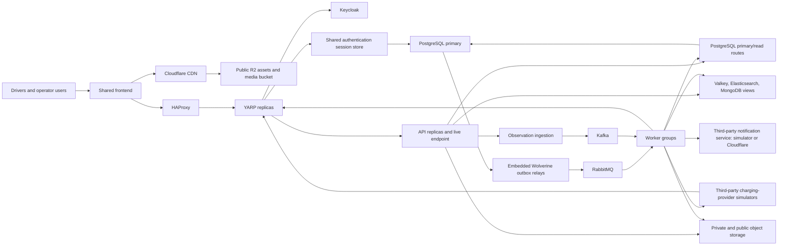
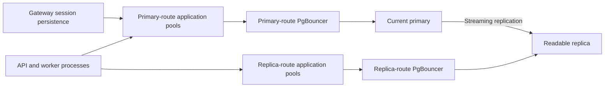
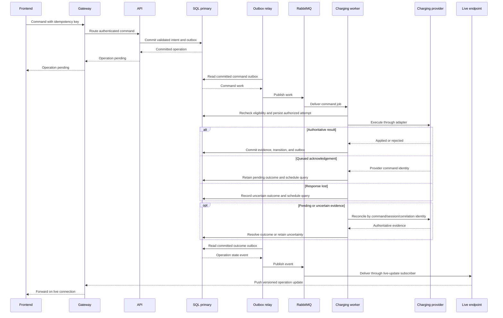

# EV Charging System Architecture

## 1. Purpose and scope

The platform is a system-design lab with a .NET/C# backend and a shared frontend
for drivers and operator users. It models production component interactions under
bounded synthetic load, including concurrency, dependency failures, and uncertain
external effects.

Drivers discover stations, reserve connectors, control charging, follow progress,
and download session summaries. Operator users maintain assigned station content,
inspect sessions and attempts, request reconciliation, and download diagnostics.
Infrastructure fault injection belongs to the test harness rather than the UI.

Billing, payments, tariffs, roaming, route planning, fleet management, and a
general maintenance platform are outside the product scope. Production capacity
planning, availability commitments, multi-region recovery, and operational
hardening are also excluded.

The documentation separates these concerns:

| Reference | Responsibility |
|---|---|
| [Domain](domain.md) | Vocabulary, permissions, reservation rules, lifecycle, and evidence semantics |
| Architecture | Components, data ownership, processing paths, and failure boundaries |
| [Integrations](integrations.md) | Third-party contracts, simulators, and adapter obligations |
| [Lab](lab.md) | Technical setup, execution profiles, timing defaults, fault scenarios, and verification |
| [Implementation plan](implementation-plan.md) | Milestones, dependencies, task tracking, and acceptance criteria |

## 2. Technology selections

| Area | Selection |
|---|---|
| Backend / frontend | .NET/C# and ASP.NET Core / shared React/TypeScript application |
| Orchestration | Aspire |
| Gateway / load balancer | YARP / HAProxy |
| Identity | Keycloak; OIDC through the gateway |
| Live delivery | SignalR with Valkey fan-out |
| Relational persistence / pooling | PostgreSQL primary/read-replica routes / PgBouncer |
| Managed database exercise | Azure Database for PostgreSQL Flexible Server; readable replica and provider-managed HA |
| Documents / cache / search | MongoDB / Valkey / Elasticsearch |
| Jobs and business events | RabbitMQ; Wolverine with PostgreSQL durability |
| Notification delivery | Local third-party service simulator / Cloudflare Email Service through an outbound adapter |
| Observation stream | Kafka |
| Object storage / CDN | Cloudflare R2 or local S3-compatible service / Cloudflare CDN |
| Default diagnostics | OpenTelemetry and Aspire Dashboard |
| Optional observability profile | OpenTelemetry Collector, Prometheus, Loki, Tempo, Grafana |

Library selections and version sources are recorded in the
[lab technical setup](lab.md#11-libraries-and-version-sources).

## 3. Components and request topology

HAProxy balances gateway replicas; YARP balances individual API destinations.
The gateway also acts as the backend for frontend (BFF), owning browser sessions
and OIDC interactions. APIs enforce resource authorization and business validation.

All application HTTP calls to platform-owned APIs pass through the gateway:
browser requests, worker submissions, and provider callbacks. The gateway routes
each request to its owning internal API. Charging-worker recovery polling calls
the provider directly and submits the resulting observations through the gateway
to ingestion. Provider and notification simulators represent external systems;
outbound integration calls use their own endpoints. Orchestration health checks
address hosts directly.

The gateway serves the SPA entry page. `/auth`, `/identity`, `/api`, and `/live`
routes share that public origin. Versioned frontend assets and published media use the CDN;
authorized file transfers use storage URLs. Authentication and API routes bypass
CDN caching.

| Supporting component | Purpose |
|---|---|
| Frontend | Driver/operator navigation, gateway session discovery, asynchronous operations, uploads, progress, and reconnect |
| Keycloak | Authentication and token issuance; application permissions remain separate |
| HAProxy | Health-aware ingress routing and gateway-instance failure exercise |
| Provider simulators | `SynchronousChargingProviderApi` and `QueuedChargingProviderApi`; controlled external APIs with distinct [command contracts](integrations.md#1-provider-contracts) |
| Notification service simulator | `NotificationProviderApi` models third-party delivery and controlled faults without sending real messages; Cloudflare replaces it through an outbound adapter |

Logical roles are assigned to a gateway deployment, an API deployment, and six
independent worker deployments. Replicas of a deployment share its responsibilities.

| Host | Responsibilities |
|---|---|
| Gateway / BFF | Browser authentication sessions, OIDC interactions, browser/service/callback routing, and API-instance balancing |
| API | Command/query acceptance, transactional reservation/operation/session intent, file authorization, observation ingestion, and SignalR connections/live-event subscription |
| Charging worker | Charging-provider adapters and start/stop effects, reservation expiry, reconciliation, recovery polling through observation ingestion, and recurring due-work discovery |
| Observation worker | Kafka consumers, MongoDB history/latest views, SQL lifecycle/final-usage processing, stalled-session detection, and isolated observation-view replay |
| Search index worker | Station/business-event and observation consumers, Elasticsearch indexing, replacement-index rebuilds, validation, and switchover |
| Cache worker | Business-event and observation consumers, versioned Valkey query-view updates, invalidation, and bounded warming/recovery |
| Media worker | Media processing/publication, summaries, diagnostic bundles, and upload/orphan sweeps |
| Notification worker | External notification delivery through a selected simulator/real-provider adapter, retries, and persisted delivery attempts |

Recurring producers run with their owning workload: reconciliation/recovery
polling in the charging worker and upload/orphan sweeps in the media worker.
Stalled-session detection submits durable reconciliation work to the charging
worker. Each worker deployment has independent queues, concurrency budgets, retry
policies, and durable recovery. Failure of one workload does not pause unrelated
worker workloads.

Notification jobs remain provider-independent. Delivery acceptance and uncertainty
follow the [notification integration contract](integrations.md#4-notification-providers).

Search indexing and cache maintenance use separate deployments, subscriber queues,
and stream consumer groups. Each owns its checkpoints and recovery. Loss or rebuild
of either derived store does not pause observation history or session-evidence
processing. API cache reads, request-time fills, and bounded fallback remain in
the API; the cache worker owns asynchronous maintenance of cached query views.
SignalR fan-out remains an API responsibility.

The outbox relay is an embedded Wolverine runtime role in each message-producing
API/worker deployment. The topology diagram represents logical roles rather than
one process per node. No process-local state is the sole record of an accepted
operation.

## 4. Data ownership

| Data | Authority / store | Derived paths |
|---|---|---|
| Station/equipment identities, assignments, descriptions | PostgreSQL primary | Replica, search, cache |
| Reservations, session lifecycle, final usage | PostgreSQL primary | Replica and frontend views |
| Operations, attempts, deadlines, inbox/outbox, notification attempts | PostgreSQL primary | Investigation views |
| Gateway authentication tickets and token state | PostgreSQL primary, dedicated session records | Shared by gateway replicas; authoritative reads bypass replicas and disposable cache |
| File ownership, processing state, publication references | PostgreSQL primary | Object delivery and media views |
| Accepted raw/normalized observation envelopes | Kafka | Independent consumer groups |
| Provider-shaped documents, observation history, latest observations | MongoDB projections | Valkey and diagnostic queries |
| Hot query results | Valkey | Reconstructable from owning stores |
| Station text, location, capabilities, advisory availability | Elasticsearch | Rebuildable discovery index |
| Originals, media variants, summaries, diagnostic bytes | Object storage | CDN or private signed transfers |

PostgreSQL owns platform decisions; the charging provider owns physical state.
Kafka is the durable acceptance boundary for observations, not an event store for
all business entities. MongoDB serves independent observational and diagnostic
queries; cache and search loss do not invalidate transactional records.

[Domain policies](domain.md#5-reservations) are enforced in primary-side
transactions. Database constraints preserve reservation/session exclusivity and
permitted transitions across API instances. Operation identity prevents duplicate
command acceptance. Observation projections follow the
[domain ordering rules](domain.md#8-time-identity-and-ordering).

## 5. Read and write paths

Command and query handling use distinct database routes within the same API
deployment. Critical decisions use authoritative primary-side state; query views
can lag and expose their freshness.

| Request | Destination |
|---|---|
| Commands, eligibility/conflict checks, lifecycle transitions, critical authorization | Primary |
| Immediate write confirmation and reads requiring the new result | Command result or primary |
| Catalog and session-history lists | Replica, optionally cache |
| Station discovery | Elasticsearch |
| Current progress | MongoDB latest view / Valkey, plus live updates |
| Diagnostics | MongoDB observations and SQL attempt records |
| Published media | CDN |
| Private files | Authorized signed object-storage URL |

Replica lag/outage triggers bounded primary fallback for admitted queries.
Other requests return a recoverable unavailable response or an explicitly stale
view. The [lab profile](lab.md#22-default-timings) defines lag tolerance. Writes
return committed identifiers/state, so a lagging history list cannot erase their
immediate confirmation.

Search failure permits a limited SQL station lookup within an admission budget.
Cache bypass uses bounded fallback, stampede controls, and gradual warm-up.
Elasticsearch rebuilds from canonical station data and selected observations;
replacement indexes are validated before switchover.

## 6. PostgreSQL topology and pooling

Each process reuses application connection pools for short database operations.
Poolers separately limit database sessions. No transaction remains open during
a provider call, upload, or notification.

Application-to-pooler and pooler-to-database budgets are measured separately.
Aggregate budgets include every process, route, and pooler, including the gateway
session store. Deliberately small server pools expose waiting under modest load.
Connection acquisition, SQL commands, and transactions have bounded waits and
cancellation. Transaction pooling is the baseline; a session-pooling comparison
demonstrates the tradeoff for session-affine operations.

Local traffic uses separate primary and replica PgBouncer containers. The Azure
exercise uses provider-managed pooler routes. Azure owns HA failure detection,
safe promotion, split-brain prevention, and primary endpoint switching. The HA
standby supports failover; the asynchronous readable replica serves queries.

The application owns bounded reconnect and uncertain-commit resolution: a lost
commit response is checked by operation identity on the authoritative database.
Reconnect cannot restore an interrupted transaction or establish whether it committed.
[Pooling implementation](lab.md#13-postgresql-access-and-pooling),
[Azure HA](https://learn.microsoft.com/en-us/azure/postgresql/flexible-server/concepts-high-availability)

## 7. Jobs, business events, and scheduling

RabbitMQ carries two workloads:

- Competing-consumer jobs execute commands, reconciliation, media processing,
  document generation, and notifications.
- Topic exchanges route committed business events to independent subscriber
  queues for projections, notifications, and derived work.

Queues isolate provider calls, files, notifications, and projections. Each has a
bounded concurrency budget; provider-specific limits prevent one failing provider
from consuming all worker capacity. Acknowledgements follow durable handling.
Bounded retries and dead-letter inspection isolate poison work.

Business changes and outgoing messages commit in one PostgreSQL transaction.
The outbox relay publishes with broker confirmation. A crash between publish
and recorded success can produce duplicate delivery. SQL consumers commit inbox
deduplication with their mutations; external effects retain separate durable
attempts and require the applicable [integration contract](integrations.md).

Each host family owns its handlers and durable-message recovery boundary.
Replicas coordinate recovery of stranded inbox/outbox work within that boundary.

Persisted scheduled messages represent expiry deadlines and delayed retries.
Scheduled jobs route to the owning worker queues. Recurring producers rescan
persisted due state after startup and periodically submit reconciliation or cleanup
work. Stable job identity makes duplicate scheduling across replicas safe; handlers
recheck current state rather than treating a scheduled message as authority.
Aspire manages the hosts; Wolverine handles persisted scheduling and recovery.
[Message persistence](lab.md#14-message-persistence-and-envelopes),
[RabbitMQ reliability](https://www.rabbitmq.com/docs/reliability)

## 8. Observation ingestion and streams

1. Authenticate the source and validate payload size, shape, IDs, and timestamps.
2. Build a versioned envelope with raw payload, normalized fields, provider/source
   identity, connector sequence, and occurrence/receipt times.
3. Append durably to Kafka before acknowledging the callback.
4. Independent consumer groups materialize documents, latest views, aggregates,
   and lifecycle evidence.

Kafka keys use provider and connector identity. Bounded raw payloads stay in the
envelope so MongoDB failure cannot lose accepted data. Large diagnostics use object
storage. Unconfirmed appends receive no success acknowledgement; ambiguous appends
can yield duplicates handled by source identity. Callback retry and polling behavior
are defined in [integrations](integrations.md#3-observations-and-recovery).

Each consumer group owns its store and checkpoint; offsets advance after durable
effects. SQL lifecycle processing commits deduplication, state, and outbox together.
MongoDB, Valkey, and Elasticsearch consumers use idempotent, version-conditional
updates; their effects are not atomic with SQL or with each other. MongoDB's latest
view is the fallback after cache loss.

Consumer lag is visible and limited by stream retention. Aggregation state has
recoverable checkpoints. Replay uses isolated consumers and rebuild targets,
validates the new view, then switches its published version. Rebuild consumers
cannot dispatch external effects. The identity, ordering, and freshness semantics
remain those of the [domain reference](domain.md#8-time-identity-and-ordering).

## 9. Charging workflows

### 9.1 Reservation

The API resolves request identity, authorizes the driver, and validates the
[reservation policy](domain.md#5-reservations) on the primary. One transaction
commits the reservation, deadline, result, and outbox event. The API returns the
committed result; subscribers update discovery and notifications asynchronously.
Cancellation, start acceptance, and expiry use conditional primary-side transitions.

### 9.2 Start/stop execution

The primary transaction owns operation acceptance. Start validates the reservation
window and claims connector exclusivity; stop targets an existing session and
retains its claim, without requiring an unexpired reservation. Workers recheck
command eligibility, persist attempt identity, and release SQL connections before
external calls. Reconciliation runs as separately scheduled durable work.
The [domain transition table](domain.md#62-session-lifecycle) defines resulting
states; [provider contracts](integrations.md) determine authoritative evidence.
Reconciliation requests from operator users use the same durable path and are audited.

### 9.3 Completion

Lifecycle consumers combine matching provider evidence under the
[completion policy](domain.md#7-measurements-and-completion). A transaction records
final usage and publishes completion. Independent jobs generate the private
summary and deliver notifications; their failures do not roll back charging facts.

## 10. Object storage and CDN

| Content | Delivery |
|---|---|
| Versioned frontend assets and published station media | Public R2 objects through Cloudflare CDN |
| Originals and pending variants | Private direct upload and worker access |
| Session summaries | Private short-lived download URL after ownership check |
| Diagnostic bundles | Private short-lived download URL after assignment check |

The storage adapter exposes upload authorization, verification, publication, and
download operations. Transfers use object-specific, short-lived signed URLs after
platform authorization. Local S3-compatible storage and hosted R2 use the same
adapter boundary.

Public assets use a dedicated subdomain of the lab-owned Cloudflare-managed domain.
Originals, pending uploads, summaries, and diagnostics remain in private storage
and bypass the CDN.

Media publication proceeds through private upload allocation, direct browser
transfer, verification, bounded image processing, then a SQL publication transaction
and outbox event. Published bytes use a distinct immutable key, so a reusable
upload URL cannot overwrite them. The previous version remains published until
replacement is ready.

Browser completion notices and storage notifications are verified hints. A sweep
reconciles missing notices, abandoned uploads, and orphan variants. Stable
asset/version identity makes retries converge after partial writes.

Cache rules cover only public assets and published media. Versioned keys handle
normal releases; the gateway-served entry page references the current build.
Urgent removal needs origin deletion and CDN purge, which is not instantaneous
everywhere. Warm caches can survive origin loss until expiry/eviction; cold
requests require the origin. Missing media produces a visible placeholder.

Signed URLs can remain valid until expiry. Tokens and signed URLs are redacted
from logs and bundles. Hosted exercises verify real signing, caching, and invalidation.
[Storage implementation](lab.md#15-storage-and-delivery),
[Cloudflare cache](https://developers.cloudflare.com/cache/)

## 11. Frontend and live delivery

The shared frontend caches server views, submits commands, and updates views from
live events or bounded refetching. Mutation retries retain request identity.
Operation labels and observation freshness follow the domain model.

Browser API and live requests use the
[gateway authentication boundary](#131-gateway-authentication).
Session expiry produces an explicit sign-in state.

Valkey carries SignalR fan-out as well as cache traffic, with isolated budgets.
Live delivery is transient rather than a durable event log. Affinity keeps live
connection establishment on one API instance. Gateway replicas share authentication
sessions; API replicas share live updates through the backplane.

Instance loss triggers bounded reconnect/backoff, renegotiation, an authoritative
snapshot, then version-aware incremental updates. Polling is a bounded fallback.
The UI shows connection health separately from charger health and preserves
last-observation timestamps.
[Frontend implementation](lab.md#16-frontend-and-live-clients)

## 12. Resilience boundaries

HTTP policies are explicit per provider and operation. Effect retries and hedging
are disabled unless permitted by the integration contract. HTTP method or library
defaults do not establish safety. A persisted operation budget covers HTTP attempts,
worker retries, and redelivery; reconciliation has a separate query budget.
[Lab defaults](lab.md#22-default-timings) set the baseline limits.

Per-dependency deadlines, cancellation, circuit breaking, concurrency limits, and
backpressure bound overload. Optional cache/search failures do not make command-capable
APIs unready. Worker admission depends on the stores required for its effects.
Readiness is workload-specific; liveness only establishes that the process runs.

Browser, API, outbox, message, worker, and provider spans share operation, entity,
message, and correlation IDs. Diagnostics are not a business-readiness dependency.
Export buffering is bounded so telemetry-backend loss does not block core traffic.
[Lab profiles](lab.md#21-execution-profiles) define execution scope;
[fault scenarios](lab.md#24-fault-scenarios) specify recovery evidence.

## 13. Security

### 13.1 Gateway authentication

The gateway is the BFF and a confidential OIDC client using Authorization Code
with PKCE. It owns code exchange, token refresh, and logout; client credentials
and access/refresh tokens remain server-side.

Login pages and callbacks share the gateway's public origin. The browser never
uses a separate Keycloak origin; server-side exchanges use internal connectivity.
Identity administration remains private.

A PostgreSQL session store holds authentication and protected token state shared
by gateway replicas. The browser receives a protected session-reference cookie.
Refresh is coordinated per session. Store unavailability fails authenticated
requests explicitly; cache eviction cannot discard authentication state.

The gateway validates antiforgery tokens for state-changing browser requests.
API/live authentication failures return unauthorized responses rather than HTML
login redirects.

Worker submissions use service credentials; provider callbacks use their source
credentials. These routes authenticate machine callers without browser sessions
or login redirects. Routing through the gateway does not grant a worker or provider
the permissions of a driver or operator user.

### 13.2 Backend authorization

The gateway attaches authenticated identity to upstream requests. APIs validate
that identity and check ownership and station assignments against authoritative
records. Gateway authentication does not replace resource authorization.

Callbacks, internal services, and infrastructure connections are authenticated.
Database/storage roles have least privilege; replicas are read-only and migrations
use a separate role. Upload size/types, decoding resources, and signed URL lifetimes
are bounded. Credentials, tokens, and private data stay out of Git and diagnostics.
Station edits, publication, reconciliation, and diagnostic access are audited.
All business fixtures are synthetic.
[Authentication conventions](lab.md#17-gateway-authentication-conventions)

## 14. Orchestration and cloud boundaries

Aspire defines processes, containers, endpoints, parameters, references, and startup
dependencies. It runs the local topology and exposes resource status; it does not
participate in charging requests or persist business work. Startup ordering does
not replace runtime recovery.

Services discover dependencies by logical name through the orchestrated resource
graph. Environment configuration supplies addresses, ports, and credentials.
Shared runtime conventions provide instrumentation and health signals for that
graph. [Application wiring](lab.md#12-application-wiring) defines the
implementation mechanics.

Most components run locally. Cloudflare supplies hosted R2/CDN and email delivery;
Azure supplies managed PostgreSQL failover. The application does not implement those
provider responsibilities. [Lab profiles](lab.md#21-execution-profiles) define the
active resources for each exercise.

Portability rests on configurable endpoints and PostgreSQL, MongoDB, Valkey's RESP
protocol, Elasticsearch, RabbitMQ, Kafka, S3-compatible storage, OIDC,
OpenTelemetry, and OCI interfaces. PostgreSQL replication/transaction behavior
remains database-specific; S3 compatibility is limited to verified operations.
Storage signing, CDN publication/purge, and notification delivery remain adapter boundaries.
