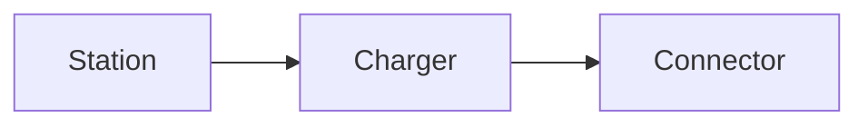

# EV Charging Domain Reference

## 1. Purpose

This reference defines canonical vocabulary and business rules for the EV charging
lab. [Architecture](architecture.md) describes system boundaries;
[integrations](integrations.md) defines third-party contracts; [lab profiles](lab.md)
supply configurable experiment timings.

Provider-specific names remain in source payloads and map to these terms at adapter
boundaries. APIs, messages, tests, and frontend labels preserve the same meanings.

## 2. Actors and permissions

| Term | Meaning |
|---|---|
| Driver | Authenticated person who reserves connectors and controls their own sessions |
| Operator user | Human responsible for assigned stations and business recovery through the backoffice |
| Charging provider | External system/organization operating equipment and reporting physical state |
| Platform | Application owning reservations, operations, sessions, and access decisions |
| Charging-provider simulator | Controlled substitute for a charging provider, owning simulated physical state |
| Notification provider | Third-party service responsible for message delivery; the lab can substitute a simulator |
| Driver area / operator area | Separate navigation and workflows within the shared frontend |

Station catalogue and equipment details are public, including address, coordinates,
photos, and access instructions. Browsing does not require an account or a driver role.
Reservations, charging controls, personal records, and operator workflows require
authentication and their applicable role, ownership, or station assignment.

Drivers access their own reservations, sessions, and summaries. Assigned operator
users edit station content, inspect operations, request reconciliation, and access
diagnostic bundles. An operator role does not grant access to every station.
Account administration, assignment-management workflows, and manual overrides of
physical charging state are outside the feature set.

Driver registration requires a verified email, whether credentials are managed
by the identity provider or obtained through a supported external sign-in provider.
The platform creates a driver profile before granting access to driver workflows.
Email is required on that profile. Signing in, creating a reservation, and
cancelling a reservation do not change it. Notifications use the driver's current
stored email when prepared. Account email changes require verification and explicit
synchronization to the profile.

Station content edits reject a stale editor version rather than overwrite changes
saved after that version was loaded. Rejected edits do not create a saved-change audit record.

## 3. Equipment

| Term | Definition |
|---|---|
| Station | Driver-facing site with address, coordinates, equipment, photos, and access instructions |
| Site / location | Geographic grouping; `station` is the canonical project term |
| Charger | Physical charging stand at a station, assigned to one charging provider |
| Connector | Independently reservable plug/socket on a charger, with connector type, AC/DC supply, and rated power |
| Connector type | Vehicle-compatibility category, distinct from connector identity |
| Capability | Advertised properties such as connector type, AC/DC supply, or maximum power |
| Access instructions | Published guidance on finding and accessing equipment |

Each connector is an independent capacity boundary: distinct connectors on a
charger can be reserved and used simultaneously. Alternative cables that share
one charging position, shared power allocation, and load management are
unsupported. Provider equipment addressing does not change platform capacity.

Industry names and equipment hierarchies differ: a protocol's charge point or
charging station need not mean this project's driver-facing site.
[OCPI equipment model](https://github.com/ocpi/ocpi/blob/2.3.0/release/core/mod_locations.asciidoc)

Connector display numbers are unique within a charger. These labels are distinct
from entity identifiers.

## 4. Business records

| Concept | Meaning |
|---|---|
| Reservation | Platform allocation of a connector to a driver during a time slot; no hardware reservation guarantee |
| Time slot | Requested booking interval, distinct from actual session duration |
| Charging session | One platform charging lifecycle, including periods without energy transfer |
| Provider session | External physical-activity record correlated with a platform session |
| Charging command | Start/stop intent, not proof of execution |
| Operation | Durable record of one logical command; repeated submission can resolve to this record |
| Attempt | One execution attempt within an operation |
| Observation | Source-identified state or measurement at a reported time |
| Telemetry | Series of charging-provider observations; distinct from application observability |
| Reconciliation | Comparing external evidence with platform records to resolve divergence or uncertainty |
| Notification | Message generated from a platform event; delivery failure does not reverse that event |
| Delivery attempt | One notification-provider call and its recorded acceptance, rejection, or uncertain outcome; distinct from a charging attempt |

A temporary booking-hold lifecycle is outside scope. Discovery availability is
advisory: an accepted booking cannot guarantee usable hardware when an external
fault, conflicting activity, or session overrun occurs.

## 5. Reservations

Slots use UTC half-open intervals `[start, end)`; adjacent intervals do not overlap.
Applicable reservations for the same connector cannot overlap. Simulators receive
charging commands, not external reservation requests.

Booking admission requires finite instants, an end after the start, and a start
at or after the current UTC time. The duration and advance-booking horizon must
fit the configured reservation policy. Acceptance immediately creates an active
reservation; no separate confirmation stage applies.

The policy configures the maximum outstanding reservations per driver, maximum
booking duration, maximum advance-booking horizon, and arrival allowance.
Limits must be positive; the outstanding-booking quota is an integer.
[Lab policy settings](lab.md#221-reservation-policy-experiments) define the initial
experiment values. Ownership, overlap protection, and uncertain-effect safety
remain invariants, not configurable switches.

A driver's active, unused reservations count toward the outstanding-booking
quota across all stations, except allocations already eligible for expiry.
Reservations with pending or uncertain starts retain their quota allocation.
Consumed, cancelled, and expired reservations do not count. Active and
consumed slots for the same driver cannot overlap, even on different connectors.
Consumed reservations retain their original interval for both driver and
connector overlap checks.

Admission and quota enforcement are atomic across concurrent requests. Due,
eligible unused reservations are excluded from the outstanding count without
changing their stored state during admission; delayed expiry processing cannot
indefinitely block the driver's quota. Expiry separately records the state
transition and its timestamp.
Authorized external starts with pending or uncertain outcomes retain their claims
under the rules below.

Each booking retains its accepted slot and a persisted arrival deadline:
the earlier of the slot end and the slot start plus the configured arrival
allowance. Policy changes affect new bookings, without recalculating accepted
deadlines or cancelling existing bookings. A lower quota blocks additional
bookings until the driver has room under the new limit.

| State | Meaning |
|---|---|
| Active | Accepted allocation not cancelled, consumed, or expired |
| Consumed | A linked session's start has been confirmed |
| Cancelled | Eligible allocation released by an authorized cancellation |
| Expired | Unused allocation released at its applicable deadline, without an unresolved external start effect |

### 5.1 Start and expiry

Start requires the driver's active reservation within its slot and before its
arrival deadline. There is no early-start or late-arrival grace period. Ownership,
current time, reservation state, and connector exclusivity are checked at intent
acceptance and before each external start attempt.

At or after the arrival deadline, no new external start attempt is authorized,
including an idempotent retry that could initiate charging. Existing attempts can
be reconciled.
An unused reservation with no pending start expires at the deadline. If no
external attempt was authorized, an unexecuted queued start is rejected locally,
its session fails, and the unused reservation expires.

An authorized attempt with unresolved outcome retains its execution claim:
deadline expiry does not prove the provider did nothing. An established session
can continue beyond the slot until stopped; reservation expiry is not a stop.

### 5.2 Cancellation, consumption, and exclusivity

Cancellation is allowed only for an active reservation without a pending or
uncertain start. Cancellation and start acceptance are atomic competing transitions.

Cancellation and expiry retain the instant of their state transition. Expiry
processing time is distinct from the applicable booking deadline; processing
delays do not move the deadline. Repeated processing preserves recorded
transition times.

Confirmed start consumes the reservation. Definitive rejection fails that session
and releases its execution claim. Before the arrival deadline, the reservation
permits cancellation or another start with a new operation/session. Otherwise it
expires. Each reservation permits at most one successful session.

At most one nonterminal platform session can claim a connector. Starting, active,
and stopping sessions block another start even after the slot ends. This execution
claim is separate from booking overlap: a consumed booking retains its original
interval even if its session finishes early. Later nonoverlapping bookings can be
accepted, but their start can be blocked by an overrun.

### 5.3 Notifications

Reservation creation, cancellation, and expiry each produce one logical notification.
Delayed notifications describe the original event even if the reservation has since
changed. Once prepared, a notification's recipient and content remain fixed.

## 6. State model

Four dimensions remain separate:

| Dimension | Represents |
|---|---|
| Reservation state | Platform allocation for a driver and interval |
| Session lifecycle | Progress of the platform charging workflow |
| Command outcome | Evidence about a requested effect |
| Observed state and freshness | Last reported physical condition and its age/validity |

### 6.1 Command outcomes

| Outcome | Meaning |
|---|---|
| Pending | Durable intent exists; effect outcome has not been established |
| Confirmed | Matching authoritative evidence establishes the intended effect |
| Rejected | Definitive evidence establishes that the request did not apply and cannot later apply |
| Uncertain | The effect may have occurred, but evidence is insufficient |

A provider acknowledgement can mean only that a request was queued. Confirmation
depends on the [provider contract](integrations.md#1-provider-contracts).
Attempt failure, command rejection, and session failure are distinct; a transport
timeout does not establish rejection.

Exhausted automatic work requires operator investigation without inventing an
outcome. Uncertain work remains uncertain, and untouched pending work remains
pending unless another rule, such as pre-attempt expiry, resolves it. Later
transport failures or delayed acknowledgements do not regress confirmed outcomes.

### 6.2 Session lifecycle

| State | Meaning |
|---|---|
| Starting | Start intent exists; confirmation is pending |
| Active | Start is established; energy transfer can pause |
| Stopping | Stop intent exists or finalization is pending |
| Completed | Terminal provider state and valid final usage are established |
| Failed | Start was definitively rejected or expired before any external attempt was authorized |

| Current state | Evidence/action | Result |
|---|---|---|
| No session | Eligible start intent accepted | Starting |
| Starting | Start confirmed | Active; reservation consumed |
| Starting | Definitive rejection or pre-attempt expiry | Failed |
| Starting | Unresolved effect | Starting; execution claim retained |
| Active | Stop intent accepted | Stopping |
| Stopping | Stop definitively rejected | Active |
| Stopping | Uncertain stop or missing final usage | Stopping; execution claim retained |
| Active or Stopping | Matching terminal state and final usage | Completed |

The normal path is `Starting → Active → Stopping → Completed`. Provider-reported
termination can complete an active session under the same evidence requirements.
Completed and failed sessions are terminal; another start uses a new session.
Zero power, stale telemetry, and a stop acknowledgement alone do not complete one.

### 6.3 Observed state and freshness

| Term | Meaning |
|---|---|
| Available | Provider reports ability to accept new use; booking/execution rules still apply |
| Charging | Provider reports energy transfer or its mapped charging state |
| Stopped | Energy transfer stopped; finalization may still be pending |
| Faulted | Explicit equipment fault, retaining its scope/details |
| Offline | Explicit charging-provider-reported connectivity condition |
| Unknown | Evidence cannot establish the physical condition |
| Fresh | Accepted current observation has a valid source time within the age limit |
| Stale | Source-observation age exceeds the configured limit |

Freshness accompanies state: `Charging, stale` preserves the last report without
claiming current activity. Silence establishes staleness, not stopped or offline.
Missing/invalid timestamps cannot establish freshness. Reprocessing old evidence
does not refresh it. Views preserve connector-level state; there is no separate
station-wide availability algorithm.

## 7. Measurements and completion

| Quantity | Canonical convention |
|---|---|
| Power | kW; instantaneous transfer rate |
| Energy | Decimal kWh; session cumulative total distinguished from device lifetime meter |
| Rated power | Advertised limit, not actual transfer rate |
| Meter reading | Value with source, time, unit, and cumulative/incremental/instantaneous meaning |
| State of charge | Optional vehicle-reported percentage; unknown is not zero |
| Duration | Named interval in explicit units; elapsed session time differs from charging time |

Normal readings carry nondecreasing cumulative energy for one provider session.
Canonical usage takes the latest valid total rather than summing snapshots.
Rated power times elapsed time is not authoritative usage. Metered transfer
need not equal battery energy or imply a battery percentage.
[OCPI measurements](https://github.com/ocpi/ocpi/blob/2.3.0/release/core/mod_sessions.asciidoc)

Completion requires a matching authoritative terminal provider state and final
session energy. These can arrive separately or out of order; a confirmed stop can
remain stopping while usage is pending. Missing readings, decreasing totals,
meter resets, and conflicting session identities are diagnostic anomalies.
Calibration, rollover handling, and automatic usage correction are outside scope.

Completion freezes final usage and session-summary content. Later contradictions
remain diagnostic evidence without rewriting either. File regeneration uses the
same frozen facts; file or notification failure does not change completion.

## 8. Time, identity, and ordering

### 8.1 Time

| Term | Meaning |
|---|---|
| Occurred at / event time | Provider-reported observation time |
| Received at | Platform receipt time |
| Processed at | Consumer handling time |
| Last observed at | Source occurrence time of the accepted current observation |
| Deadline | Persisted instant after which an eligibility/recovery rule applies |

Instants are UTC. Driver booking inputs, reservation slots, and lifecycle timestamps
use the browser's local time zone, explicitly labelled in the UI. Relative day
labels such as today, tomorrow, and yesterday use that same zone. Browser-local
booking times resolve to UTC instants. Stations retain a named time zone as site
metadata; station time does not reinterpret browser-local input. Local wall time
alone is insufficient across daylight-saving changes.
Normal simulator clocks share the lab UTC clock. Clock skew can be
injected; infrastructure time synchronization is outside scope.

### 8.2 Identity and idempotency

| Identifier | Scope/meaning |
|---|---|
| `stationId`, `chargerId`, `connectorId` | Stable platform equipment identities, independent of labels |
| `providerId` | External charging-provider integration |
| Provider entity/session ID | Namespaced by provider and relevant parent |
| `reservationId` / `sessionId` | One platform booking / charging lifecycle |
| `operationId` / `attemptId` | Logical action / one execution attempt |
| Idempotency key | Platform submissions scoped by driver, action, and key |
| `observationId` | Platform observation-envelope identity |
| Source event ID | Provider event identity under its integration contract |
| Correlation ID | Links workflow records; does not deduplicate effects |

Resource IDs in public contracts identify resources independently of internal
storage keys.

The same external ID can exist at different charging providers. Equal measurement values
can represent distinct events.

The same idempotency key and request return the existing operation; reuse with a
different request is rejected. Lookup precedes new-operation eligibility checks,
so a retry after slot expiry still returns the accepted operation. Platform
idempotency does not make provider effects safe to repeat.

### 8.3 Ordering and recovery

Source event identity distinguishes duplicate delivery. Higher connector sequences
can update current state; older unique observations remain history. Historical
evidence can fill a missing session fact without regressing equipment state.
Receipt/partition order alone does not prove newer physical evidence. The
[integration contract](integrations.md#3-observations-and-recovery) defines sequence
scope and continuity.

Retry repeats logical work; redelivery repeats message delivery; replay reprocesses
retained history. Reconciliation resolves outcomes using external evidence.
Replay cannot authorize charging commands or notifications and cannot refresh
source timestamps.

## 9. Files

| Term | Meaning |
|---|---|
| Station media / asset | Identified photo or illustrated instruction with ownership and processing state |
| Upload original | Private source bytes awaiting verification |
| Media variant | Processed representation such as a thumbnail |
| Object / object key | Stored bytes / storage address, distinct from domain identity |
| Published media | Validated version referenced by publication metadata |
| Signed URL | Time-limited transfer permission, not stable file identity |
| Session summary | Private usage document from completed facts; not an invoice or fiscal receipt |
| Diagnostic bundle | Private sanitized observations, attempts, and provider responses for investigation |

Uploaded, processed, and published are distinct milestones. Object existence alone
does not make media visible. Diagnostic generation does not modify the session.

## 10. Industry terminology

| Term | Meaning and project relationship |
|---|---|
| CPO | Charge Point Operator; industry term for an external charging provider |
| eMSP | e-Mobility Service Provider; some analogous driver-service functions, without full roaming |
| CSMS | Charging Station Management System; represented only by focused simulator behavior |
| OCPP | Equipment-to-management protocol; not implemented by this lab |
| OCPI | Charging-provider/service-provider exchange; vocabulary reference, not full implementation |
| CDR | Charge Detail Record for charging/settlement; distinct from the session summary |

Industry references do not imply protocol certification, roaming, settlement, or
physical charger firmware coverage.
[OCPP overview](https://openchargealliance.org/protocols/open-charge-point-protocol/),
[OCPI specification](https://github.com/ocpi/ocpi)

## 11. Naming conventions

| Ambiguous term | Canonical usage |
|---|---|
| operator | Operator user for the human backoffice actor |
| provider | Charging provider for the external charging system; other provider roles are qualified |
| station / port | Station for a site; charger and connector for equipment |
| status | Qualified reservation, lifecycle, outcome, or observed-state dimension |
| transaction / session | Qualified database, charging, login, or provider context |
| accepted | Boundary acknowledgement, with confirmation stated separately |
| failed | Definitive failure; missing response is an uncertain outcome |
| offline / faulted / stale | Distinct connectivity, equipment, and evidence conditions |
| energy consumption | Named measurement boundary and unit |
| receipt | Session summary for the lab's usage document |

Naming follows canonical nouns across documentation and contracts; casing follows
language conventions. `SessionCompleted` is a fact; `GenerateSessionSummary` is
work. UI labels can be friendlier while retaining semantics: `Confirming start`
for pending/uncertain execution, `Last reported charging` for stale observations.
